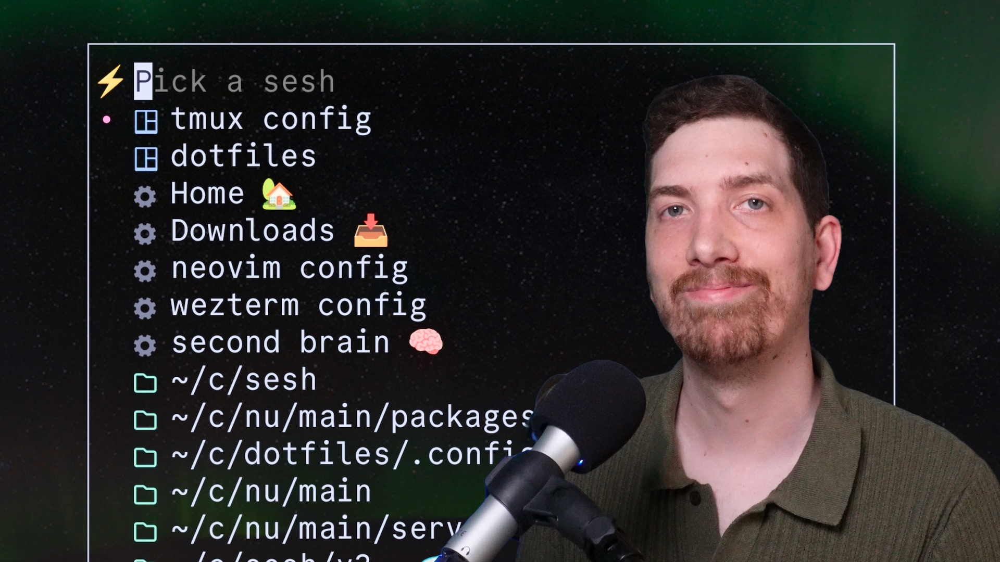

<p align="center">
  
</p>

<h1 align="center">Sesh，智能 tmux 会话管理器</h1>

<p align="center">
  <a href="https://github.com/joshmedeski/sesh/actions/workflows/test.yml">
    
  </a>
  <a href="https://pkg.go.dev/github.com/joshmedeski/sesh/v2">
    
  </a>
  <a href="https://opensource.org/licenses/MIT">
    
  </a>
</p>

<div align="center">

[English](README.md) | [简体中文](README.zh-cn.md)

</div>

Sesh 是一个 CLI 工具，可帮助您使用 zoxide 快速轻松地创建和管理 tmux 会话。

- **智能创建会话** - 根据 git 仓库、git 远程或目录自动为会话命名
- **集成 zoxide** - 立即跳转到您最常用的项目
- **会话配置** - 在 `sesh.toml` 中为每个项目定义启动命令、窗口、窗格和预览命令
- **通配符配置** - 将设置应用于所有匹配 glob 模式的项目
- **内置选择器** - 交互式会话选择器，也可以与 fzf、television 或 gum 集成
- **克隆并连接** - 一步克隆 git 仓库并启动会话
- **创建目录并连接** - 一步创建新目录（相对或绝对路径）并启动会话
- **切换到上一个会话** - 在最近的两个会话之间无缝切换
- **根会话导航** - 跳转到 git worktree 或仓库的根目录
- **Nerd Font 图标** - 在选择器中显示会话类型图标
- **Shell 补全** - 支持 Bash、Zsh、Fish 和 PowerShell 的 tab 补全

> [!NOTE]
> ⭐ 如果您觉得 sesh 有用，请为仓库加星 —— 这有助于项目成长并让更多开发者看到它！

> [!TIP]
> 想看到更多功能并帮助 sesh 走向成熟？请考虑 [赞助本项目](https://github.com/sponsors/joshmedeski) 以支持持续开发。

## 目录

<table>
  <tr>
    <td>

- [视频](#视频)
- [如何安装](#如何安装)
- [Shell 补全](#shell-补全)
- [扩展](#扩展)
- [Agent skill](#agent-skill)
- [如何使用](#如何使用)
- [推荐的 tmux 设置](#推荐的-tmux-设置)

</td>
    <td>

- [额外功能](#额外功能)
- [配置](#配置)
- [贡献](#贡献)
- [背景（“t”脚本）](#背景t脚本)
- [贡献者](#贡献者)
- [Star 历史](#star-历史)

</td>
  </tr>
</table>

## 视频

<table>
  <tr>
    <td width="50%">
      <a href="https://youtu.be/-yX3GjZfb5Y?si=iFG8qNro1hmZjJFY" target="_blank">
        
      <p><strong>Josh Medeski（sesh 作者）的介绍</strong></p>
      </a>
    </td>
    <td width="50%">
      <a href="https://www.youtube.com/watch?v=ejdzk_L6nIk" target="_blank">
        
      <p><strong>DevOps Toolbox 的评测</strong></p>
      </a>
    </td>
  </tr>
</table>

## 如何安装

<details>
  <summary>Homebrew</summary>

要安装 sesh，请运行以下 [homebrew](https://brew.sh/) 命令：

```sh
brew install sesh
```

</details>

<details>
  <summary>Arch Linux AUR</summary>

要安装 sesh，请运行以下 [yay](https://aur.archlinux.org/packages/yay) 命令：

```sh
yay -S sesh-bin
```

</details>

<details>
  <summary>Fedora（Copr）</summary>

可以从 [buckaroogeek/Tmux_sesh](https://copr.fedorainfracloud.org/coprs/buckaroogeek/Tmux_sesh/) Copr 仓库安装 sesh（支持 Fedora 和 EPEL 10）：

```sh
sudo dnf copr enable buckaroogeek/Tmux_sesh
sudo dnf install tmux-sesh
```

</details>

<details>
  <summary>RPM / DEB 软件包</summary>

从 [最新版本](https://github.com/joshmedeski/sesh/releases/latest) 下载适合您架构的 `.rpm` 或 `.deb` 文件，然后使用您的包管理器安装：

```sh
# openSUSE
sudo zypper install ./sesh_*_linux_amd64.rpm

# Fedora / RHEL
sudo dnf install ./sesh_*_linux_amd64.rpm

# Debian / Ubuntu
sudo apt install ./sesh_*_linux_amd64.deb
```

根据需要将 `amd64` 替换为 `arm64` 或 `386`。

</details>

<details>
  <summary>Go</summary>

或者，您可以使用 Go 的 `go install` 命令安装 Sesh：

```sh
go install github.com/joshmedeski/sesh/v2@latest
```

这将下载并安装最新版本的 Sesh。请确保您的 Go 环境已正确设置。

</details>

<details>
  <summary>Conda</summary>

要安装 sesh，请根据您的设置运行以下 **其中一个** 命令：

- Conda/(micro)mamba 用户

```sh
# 如果需要，请替换为 mamba/micromamba
conda -c conda-forge install sesh
```

- Pixi 用户

```sh
pixi global install sesh
```

</details>

<details>
  <summary>Nix</summary>

有关如何通过 nix 平台安装 sesh 的说明，请参阅 [nix 软件包目录](https://search.nixos.org/packages?channel=unstable&show=sesh&from=0&size=50&sort=relevance&type=packages&query=sesh)。

</details>

**注意：** 您希望在其他包管理器上使用它吗？[创建一个 issue](https://github.com/joshmedeski/sesh/issues/new) 让我知道！

## Shell 补全

Sesh 支持 Bash、Zsh、Fish 和 PowerShell 的 shell 补全（tab 补全）。这可以帮助您通过按 Tab 键发现命令、标志和参数。

<details>
  <summary>Bash</summary>

```sh
# 生成补全脚本
sesh completion bash > sesh-completion.bash

# 系统范围安装（推荐）
sudo cp sesh-completion.bash /etc/bash_completion.d/

# 或仅为当前用户安装
mkdir -p ~/.local/share/bash-completion/completions
cp sesh-completion.bash ~/.local/share/bash-completion/completions/sesh

# 重新加载您的 shell
source ~/.bashrc
```

</details>

<details>
  <summary>Zsh</summary>

```sh
# 生成补全脚本
sesh completion zsh > _sesh

# 系统范围安装（推荐）
sudo mkdir -p /usr/local/share/zsh/site-functions
sudo cp _sesh /usr/local/share/zsh/site-functions/

# 或仅为当前用户安装
mkdir -p ~/.zsh/completions
cp _sesh ~/.zsh/completions/
echo 'fpath=(~/.zsh/completions $fpath)' >> ~/.zshrc
echo 'autoload -U compinit && compinit' >> ~/.zshrc

# 重新加载您的 shell
source ~/.zshrc
```

</details>

<details>
  <summary>Fish</summary>

```sh
# 生成并安装补全
sesh completion fish > ~/.config/fish/completions/sesh.fish

# 重新加载 fish 配置
source ~/.config/fish/config.fish
```

</details>

<details>
  <summary>PowerShell</summary>

```powershell
# 生成补全脚本
sesh completion powershell > sesh.ps1

# 如果 PowerShell 配置文件目录不存在，则创建它
mkdir -p (Split-Path $PROFILE)

# 添加到 PowerShell 配置文件
Add-Content $PROFILE ". /path/to/sesh.ps1"

# 重新加载 PowerShell
& $PROFILE
```

</details>

设置补全后，您可以在键入 `sesh` 时按 Tab 键以查看可用的命令、标志和参数。

## 扩展

## Raycast 扩展

适用于 [Raycast](https://www.raycast.com/) 的 [sesh 配套扩展](https://www.raycast.com/joshmedeski/sesh) 使在终端外使用 sesh 变得容易。

请记住以下限制：

- 在使用扩展之前，tmux 必须正在运行
- 扩展会缓存几秒钟的结果，因此可能不总是最新的

<a title="Install sesh Raycast Extension" href="https://www.raycast.com/joshmedeski/sesh"></a>

## Ulauncher 扩展

对于使用 [Ulauncher](https://ulauncher.io/) 的 Linux 用户，有两个扩展可以在终端外使用 sesh：

- [Sesh Session Manager](https://ext.ulauncher.io/-/github-jacostag-sesh-ulauncher)
- [SESHion Manager](https://ext.ulauncher.io/-/github-mrinfinidy-seshion-manager)

以下是 Sesh Session Manager 需要注意的限制：

- 在使用扩展之前，tmux 必须正在运行

## Walker 启动器用法 (Linux)

直接在 `$XDG_CONFIG_HOME/config.toml` 上创建一个动作

```
[[plugins]]
name = "sesh"
prefix = ";s "
src_once = "sesh list -d -c -t -T"
cmd = "sesh connect --switch %RESULT%"
keep_sort = false
recalculate_score = true
show_icon_when_single = true
switcher_only = true
```

### 对于 dmenu 模式，您可以使用：

#### Fish shell:

set ssession $(sesh l -t -T -d -H | walker -d -f -k -p "Sesh sessions"); sesh cn --switch $ssession

#### Bash/Zsh:

ssession=$(sesh l -t -T -d -H | walker -d -f -k -p "Sesh sessions"); sesh cn --switch $ssession

##### 对于 dmenu 启动器，请将 walker -dfk 替换为 dmenu 或 rofi)

## Agent skill

Sesh 附带一个 [agent skill](https://agentskills.io)，教会编码 agent 通过 sesh 开始工作，而不是直接调用 `tmux new-session`、`tmux new-window` 和 `tmux send-keys`。安装了它的 agent 会根据工作是否属于已打开的内容来选择会话或窗口，在 tmux、zoxide、配置和 tmuxinator 之间解析名称和目录，复用已在运行的内容而不是重复创建，并且在工作只是后台步骤时让您留在原处。

使用 [`skills`](https://github.com/vercel-labs/skills) CLI 安装：

```sh
# 全局安装，适用于所有项目
npx skills add joshmedeski/sesh -g

# 或仅安装到当前项目
npx skills add joshmedeski/sesh
```

它适用于 Claude Code、Codex、Cursor、OpenCode 以及 [数十种其他 agent](https://github.com/vercel-labs/skills#supported-agents) —— `skills add` 会询问要安装到哪些 agent，也可以通过 `-a claude-code` 指定。

该 skill 位于 [`skills/sesh/SKILL.md`](skills/sesh/SKILL.md)，并与 CLI 一起进行版本管理，因此 `npx skills update sesh` 会获取更新。如果想手动安装，请将该文件复制或符号链接到 `~/.claude/skills/sesh/SKILL.md`（或您的 agent 对应的 skills 目录）。

### 如何使用

### 用于会话的 tmux

[tmux](https://github.com/tmux/tmux) 是一个功能强大的终端多路复用器，可让您创建和管理多个终端会话。Sesh 旨在使管理 tmux 会话更容易。

### 用于目录的 zoxide

[zoxide](https://github.com/ajeetdsouza/zoxide) 是 `cd` 的一个极速替代品，可以跟踪您最常用的目录。Sesh 使用 zoxide 来管理您的项目。您必须先设置 zoxide，但一旦完成，您就可以使用它快速跳转到您最常用的目录。

### 基本用法

一旦 tmux 和 zoxide 设置好，`sesh list` 将列出您所有的 tmux 会话和 zoxide 结果，而 `sesh connect {session}` 将连接到一个会话（如果尚不存在，则自动创建）。最好通过将其集成到您的 shell 和 tmux 中来使用。

#### fzf

将 sesh 集成到工作流中的最简单方法是使用 [fzf](https://github.com/junegunn/fzf)。您可以用它来选择要连接的会话：

```sh
sesh connect $(sesh list | fzf)
```

#### tmux + fzf

为了与 tmux 集成，您可以向 tmux 配置（`tmux.conf`）添加一个绑定。例如，以下命令会将 `ctrl-a T` 绑定为以 tmux 弹出窗口的形式打开 fzf 提示（使用 `fzf-tmux`），并使用不同的命令列出活动会话（`sesh list -t`）、已配置的会话（`sesh list -c`）、zoxide 目录（`sesh list -z`）和查找目录（`fd...`）。

```sh
bind-key "T" run-shell "sesh connect \"$(
  sesh list --icons | fzf-tmux -p 80%,70% \
    --no-sort --ansi --border-label ' sesh ' --prompt '⚡  ' \
    --header '  ^a all ^t tmux ^g configs ^x zoxide ^d tmux kill ^f find' \
    --bind 'tab:down,btab:up' \
    --bind 'ctrl-a:change-prompt(⚡  )+reload(sesh list --icons)' \
    --bind 'ctrl-t:change-prompt(🪟  )+reload(sesh list -t --icons)' \
    --bind 'ctrl-g:change-prompt(⚙️  )+reload(sesh list -c --icons)' \
    --bind 'ctrl-x:change-prompt(📁  )+reload(sesh list -z --icons)' \
    --bind 'ctrl-f:change-prompt(🔎  )+reload(fd -H -d 2 -t d -E .Trash . ~)' \
    --bind 'ctrl-d:execute(tmux kill-session -t {2..})+change-prompt(⚡  )+reload(sesh list --icons)' \
    --preview-window 'right:55%' \
    --preview 'sesh preview {}'
)\""
```

您可以根据需要自定义此项，有关不同选项的更多信息，请参阅 `man fzf`。

要持续刷新活动 tmux 会话的预览，请在预览命令中添加 `--watch`：

```sh
--preview 'sesh preview --watch {}'
```

监视模式只轮询活动的 tmux 会话；目录和已配置会话的预览仍然只渲染一次。默认间隔为 500 毫秒，可以通过 `--interval 100ms` 更改。

#### 自定义列表格式

`--format` 让外部选择器可以控制 `sesh list` 每一行的渲染方式，而不改变默认输出。可用的占位符如下：

| 占位符 | 值 |
| --- | --- |
| `{name}` | 正常的显示名称，设置 `--icons` 时包含来源图标 |
| `{session}` | 原始会话名称 |
| `{source}` | 会话来源（`tmux`、`config`、`zoxide` 等） |
| `{path}` | 会话路径 |
| `{active_window_name}` | 活动 tmux 窗口的名称；非 tmux 会话为空 |
| `{active_window_name_prefix}` | 活动窗口名称后跟一个空格；没有时为空 |

例如，与 tmux 插件 [tmux-nerd-font-window-name](https://github.com/joshmedeski/tmux-nerd-font-window-name) 结合使用：

```sh
sesh list --icons --format '{active_window_name_prefix}{name}'
```

```text
  neovim-config
  sesh
 dotfiles
```

如果要用活动窗口图标 *代替* 正常的 tmux 来源图标，同时保留 config/zoxide 等的来源图标，只需排除 tmux 来源图标：

```sh
sesh list --icons --icons-exclude tmux --format '{active_window_name_prefix}{name}'
```

可以直接在格式中使用 `{fg:COLOR}` 和 `{/fg}` 设定前景色范围。这样样式保留在格式中，而不是将颜色绑定到特定占位符：

```sh
sesh list --icons --icons-exclude tmux \
  --format '{fg:yellow}{active_window_name_prefix}{/fg}{name}'
```

颜色可以应用于行的任何部分，例如：

```sh
sesh list --format '{fg:gray}{source}{/fg} {fg:bright-cyan}{active_window_name}{/fg} {name}'
```

支持的颜色有 `black`、`red`、`green`、`yellow`、`blue`、`magenta`、`cyan`、`white` 及其 `bright-*` 变体。`gray`/`grey` 是 `bright-black` 的别名。`--no-color` 会移除格式中的颜色标记以及内置的来源图标着色。

活动窗口名称通过一次 tmux 调用实时获取，并且仅在格式使用了活动窗口名称占位符时才会获取。tmux 查询失败只会让这些占位符为空。`--format` 不能与 `--json` 一起使用。

`sesh list --json` 报告连接时实际会使用的内容：每个会话解析后的 `Icon`（与选择器显示的相同）、它的 `Alias`、`AliasAutoConnect` 和 `Tmuxp`、匹配的 `Wildcard` 模式，以及应用了 `[[wildcard]]` 和 `[default_session]` 回退后的 `StartupCommand`、`PreviewCommand`、`WindowNames` 和 `WindowConfigs`。无论是否设置了 `[tui] show_windows`，tmux 会话都包含其实时的 `TmuxWindows`（`Name`、`Index`、`Path`、`Active`）。位于 `[[worktree]]` 根目录下的会话包含 `Worktree`（`Repo`、`Number`、`Title`、`State`），其中 `Title` 和 `State` 读取自 `sesh worktree list` 填充的 issue 缓存；其他会话均为 `null`。

任意格式化的行只是显示输出，`sesh connect` 不会将其解析回来。使用 fzf 时，请将原始会话名称保留在隐藏字段中，只显示格式化字段：

```sh
selected="$(
  sesh list --icons --format $'{session}\t{active_window_name_prefix}{name}' |
    fzf --delimiter=$'\t' --with-nth=2
)"
sesh connect "${selected%%$'\t'*}"
```

#### tmux + [television](https://github.com/alexpasmantier/television)

如果您更喜欢使用 television 而不是 fzf，您可以向 tmux 配置添加一个绑定，在 tmux 弹出窗口中打开 [sesh 通道](https://alexpasmantier.github.io/television/community/channels-unix/#sesh)。

```sh
bind-key "T" display-popup -E -w 80% -h 70% -d '#{pane_current_path}' -T 'Sesh' tv sesh
```

使用 `Ctrl-s` 循环浏览源，使用 `Ctrl-d` 终止高亮的会话。

### 窗口管理

`sesh window`（别名 `w`）让您可以在会话中列出、切换和创建 tmux 窗口 —— 类似于 `sesh list` 和 `sesh connect` 对会话的作用。它是一组子命令：

```sh
sesh window list      # 列出会话的窗口
sesh window connect   # 选择一个窗口，不存在时创建
```

#### 列出窗口

```sh
sesh window list           # 当前附加的会话
sesh window list -t work   # 另一个会话
sesh window list -j        # 以 json 格式
```

#### 按名称切换到现有窗口

```sh
sesh window connect editor
```

如果目标会话中存在名为 `editor` 的窗口，sesh 会选中它。如果不存在，sesh 会创建它。

#### 在目录中创建新窗口

```sh
sesh window connect ~/projects/my-app
```

目录参数会以其基本名称（`my-app`）命名窗口，并以该目录为根目录。再次运行会选中第一次创建的窗口，而不是打开重复的窗口。

#### 在窗口中运行命令

```sh
sesh window connect claude -t 'second brain' -c 'claude "summarize my notes"'
```

在 **新创建** 的窗口中，该命令会成为窗口的进程，因此命令退出时窗口也会关闭。在 **已存在** 的窗口中，命令会被输入到正在运行的程序中。如果希望每次调用都获得一个全新的窗口而不是复用名称，请传入 `--new`。

#### 指定目标会话

使用 `--target` / `-t` 管理当前附加会话以外的会话中的窗口：

```sh
sesh window list -t work
sesh window connect ~/projects/my-app -t work
```

目标的解析方式与 `sesh connect` 解析会话的方式相同 —— 跨 tmux、zoxide、配置和 tmuxinator —— 如果尚未运行则会启动它，且不会让您离开当前所在的会话。使用 `-b` / `--background` 创建窗口但不跳转过去；从终端外触发 sesh 时使用 `-s` / `--switch`。

> [!NOTE]
> `sesh window <name>` 和 `sesh window -s <session>` 已被 `sesh window connect <name>` 和 `sesh window list -t <session>` 取代。`--session` 仍可作为 `--target` 的已弃用别名使用，而 `-s` 在 `sesh window connect` 上现在表示 `--switch`，与 `sesh connect` 保持一致。

#### fzf 集成

您可以将这两个子命令与 fzf 结合，交互式地切换窗口：

```sh
sesh window connect "$(sesh window list | fzf)"
```

或者作为 tmux 键位绑定：

```sh
bind-key "W" run-shell "sesh window connect \"$(sesh window list | fzf-tmux -p 60%,50% --prompt '🪟  ')\""
```

### 创建目录并连接

`sesh mkdir`（别名 `md`）将 `mkdir` 和 `sesh connect` 合并为一步：如果目录不存在则创建它，然后将其作为会话连接 —— 无需先 `cd` 进入，也无需等待 zoxide 收录。

```sh
sesh mkdir my-new-project
```

`<path>` 同时接受 **相对** 路径（相对于当前工作目录解析）和 **绝对** 路径，也支持用 `~` 表示主目录：

```sh
sesh mkdir my-new-project        # 相对于当前目录
sesh mkdir ~/projects/my-app     # 相对于主目录
sesh mkdir /Users/josh/dev/api   # 绝对路径
```

## gum + tmux

如果您更喜欢使用 [charmbracelet's gum](https://github.com/charmbracelet/gum)，那么您可以使用以下命令连接到会话：

```sh
bind-key "K" display-popup -E -w 40% "sesh connect \"$(
 sesh list -i | gum filter --limit 1 --no-sort --fuzzy --placeholder 'Pick a sesh' --height 50 --prompt='⚡'
)\""
```

**注意：** 与 fzf 相比，gum 提供的功能较少，但我发现它的匹配算法更快，并且感觉更现代。

> [!WARNING]
> 从 [gum v0.15.0](https://github.com/charmbracelet/gum/releases/tag/v0.15.0) 开始，您必须添加 `--no-strip-ansi` 才能正确显示图标。

请参阅我的视频 [排名前 4 的模糊 CLI](https://www.youtube.com/watch?v=T0O2qrOhauY)，以获取更多可与 sesh 集成的工具灵感。

#### sesh 选择器

Sesh 内置了一个选择器，可以作为 tmux 弹出窗口使用：

```sh
bind-key "K" display-popup -h 90% -w 50% -E "sesh picker -i"
```

## zsh 键位绑定

如果您使用 zsh，可以将以下键位绑定添加到您的 `.zshrc` 文件中以连接到会话：

```sh
function sesh-sessions() {
  {
    exec </dev/tty
    exec <&1
    local session
    session=$(sesh list -t -c | fzf --height 40% --reverse --border-label ' sesh ' --border --prompt '⚡  ')
    zle reset-prompt > /dev/null 2>&1 || true
    [[ -z "$session" ]] && return
    sesh connect $session
  }
}

zle     -N             sesh-sessions
bindkey -M emacs '\es' sesh-sessions
bindkey -M vicmd '\es' sesh-sessions
bindkey -M viins '\es' sesh-sessions
```

将其添加到您的 `.zshrc` 后，您可以按 `Alt-s` 打开 fzf 提示以连接到会话。

## 推荐的 tmux 设置

我建议您将这些设置添加到您的 `tmux.conf` 中，以便更好地体验此插件。

```sh
bind-key x kill-pane # 跳过 "kill-pane 1? (y/n)" 提示
set -g detach-on-destroy off  # 关闭会话时不要退出 tmux
```

## 额外功能

### 上一个

默认的 `<prefix>+L` 命令将“将附加的客户端切换回上一个会话”。但是，如果在设置了 `detach-on-destroy off` 的情况下关闭会话，则找不到上一个会话。为了解决这个问题，我有一个 `sesh last` 命令，它将始终将客户端切换到倒数第二个已附加的会话。

将以下内容添加到您的 `tmux.conf` 中以覆盖默认的 `last-session` 命令：

```sh
bind -N "last-session (via sesh) " L run-shell "sesh last"
```

### 用 GitHub issue 标题丰富会话名称

`sesh` 可以重命名会话，使其包含分支对应的 GitHub issue 标题，例如
`400-status` → `400-status — warm the status cache`。它从分支名称中解析 issue 编号，
并使用 `gh` CLI（必须已安装并完成认证）进行查询。

添加一个可选的 tmux 钩子，使每个新会话都在后台被丰富：

```tmux
set-hook -g session-created 'run-shell -b "sesh rename --enrich"'
```

当分支没有可解析的 issue 时，该命令不执行任何操作（会话保留其普通名称），并且它会自我修复：
切换到没有 issue 的分支会将会话重命名回其基本名称。重新连接到该目录会附加到已丰富的会话，
而不是创建重复的会话。

### 连接到根目录

在嵌套会话中工作时，您可能希望连接到 git worktree 或 git 存储库的根会话。为此，您可以将 `--root` 标志与 `sesh connect` 命令一起使用。

我建议将此添加到您的 `tmux.conf` 中：

```sh
bind -N "switch to root session (via sesh) " 9 run-shell "sesh connect --root $(pwd)"
```

### 按根目录筛选

如果要按活动项目的根目录筛选搜索，可以使用 `sesh root` 命令修改您的选择器：

```sh
bind-key "R" display-popup -E -w 40% "sesh connect \"$(
  sesh list -i -H | gum filter --value \"$(sesh root)\" --limit 1 --fuzzy --no-sort --placeholder 'Pick a sesh' --prompt='⚡'readme
)\""
```

我已将其绑定到 `<prefix>+R`，因此我可以使用备用绑定。

**注意：** 这仅在您位于 git worktree 或 git 存储库中时才有效。目前，git worktree 需要一个 `.bare` 文件夹。

## 配置

您可以通过在 `$XDG_CONFIG_HOME/sesh` 或 `$HOME/.config/sesh` 目录中创建 `sesh.toml` 文件来配置 sesh。

```sh
mkdir -p ~/.config/sesh && touch ~/.config/sesh/sesh.toml
```

### 自定义配置路径

您可以使用 `--config`（或 `-C`）标志指定自定义配置文件路径。这对于 NixOS 包装器、维护独立的工作/私人配置或测试非常有用。

```sh
sesh -C /path/to/custom/sesh.toml list
sesh --config /path/to/custom/sesh.toml connect my-session
```

该标志适用于任何子命令。指定时，文件必须存在，否则 sesh 将返回错误。如果没有该标志，sesh 将使用默认配置路径。

### 自定义多路复用器 (psmux)

Sesh 默认使用 `tmux` 作为终端多路复用器，但您可以在 `sesh.toml` 中设置 `tmux_command`，将其配置为使用任何兼容 tmux 的多路复用器，例如 [psmux](https://github.com/psmux/psmux)：

```toml
tmux_command = "psmux"
```

这会替换 sesh 运行的所有命令（创建会话、切换、附加等）中的 `tmux` 可执行文件。所配置的多路复用器必须支持 tmux 的 CLI 接口。

### 自定义 frecency 后端（fasd、autojump 等）

Sesh 默认使用 [zoxide](https://github.com/ajeetdsouza/zoxide) 作为基于 frecency 的目录跳转后端，但您可以通过在 `[frecency]` 表中覆盖命令，将其指向 [fasd](https://github.com/clvv/fasd)、[fasder](https://github.com/khwang0/fasder)、[autojump](https://github.com/wting/autojump) 或 [memy](https://github.com/xvello/memy) 等替代工具。这对于同时跟踪文件 _和_ 目录的工具很有用，而 zoxide 只跟踪目录。

```toml
[frecency]
list_command  = "fasd -d -l -R"  # 列出所有跟踪的条目
query_command = "fasd -d {}"     # 将一个输入解析为路径
add_command   = "fasd -A {}"     # 连接后记录路径
remove_command = "fasd -D {}"    # 删除路径（选择器中的 ctrl+x）
```

- `{}` 占位符会被替换为查询字符串（`query_command`）或路径（`add_command`、`remove_command`），与 `preview_command` 使用的替换方式相同。
- `list_command` 的输出按每行一个路径解析，frecency 最高的在前。如果行首有数字分数会被自动识别（如 zoxide 的 `--score`）；否则分数为 `0`。
- 每个命令都作为单个可执行文件运行（不经过 shell），因此不支持管道和重定向。
- 省略的字段会回退到 zoxide 的默认值（`zoxide query --list --score`、`zoxide query {}`、`zoxide add {}`、`zoxide remove {}`），因此不配置 `[frecency]` 表时行为不变。
- `sesh list` 输出中的来源标签仍为 `zoxide`，因此读取 `--json` 输出的现有集成可以继续工作。

### Schema（编辑器自动补全）

Sesh 为 `sesh.toml` 提供了一个 [JSON Schema](https://json-schema.org/)，可以在编辑器中启用自动补全、校验和文档提示。它适用于任何支持 [taplo](https://taplo.tamasfe.dev/) TOML 语言服务器的编辑器。

#### 快速设置

将以下行添加到 `sesh.toml` 的顶部：

```toml
#:schema https://github.com/joshmedeski/sesh/raw/main/sesh.schema.json
```

就这样！Taplo 会读取该指令并自动应用 schema。

#### Neovim

请确保已安装 taplo：

```sh
brew install taplo
```

如果您使用 [nvim-lspconfig](https://github.com/neovim/nvim-lspconfig)，taplo 配合上面的 `#:schema` 指令应当开箱即用。或者，您也可以直接配置 schema 关联：

```lua
require("lspconfig").taplo.setup({
  settings = {
    taplo = {
      schema = {
        associations = {
          [".*sesh\\.toml$"] = "https://github.com/joshmedeski/sesh/raw/main/sesh.schema.json",
        },
      },
    },
  },
})
```

### 黑名单

您可能希望将某些 tmux 会话列入黑名单，使其不显示在结果中。例如，您可能希望从结果中排除 `scratch` 目录。

```sh
blacklist = ["scratch"]
```

如需显示被列入黑名单的会话以便管理，请向 `sesh list` 传入 `-b`（或 `--blacklisted`）。它可以与来源标志组合使用，因此 `sesh list -b -t` 只列出被列入黑名单的 tmux 会话。

### 目录长度

控制会话名称使用的目录组件数量。默认为 1（仅目录的基本名称）。

```toml
dir_length = 2  # 使用最后两个目录："projects/sesh" 而不是 "sesh"
```

> [!NOTE]
> 与 [tmux-floax](https://github.com/omerxx/tmux-floax) 配合使用效果很好

### 会话名称替换

有些目录会产生冗长、重复的会话名称 —— `~/c/dotfiles/.config` 下的所有内容都会带上整个前缀。
`name_substitution` 规则会重写用于生成名称的路径，让您可以缩短或重新标记它。

```toml
[[name_substitution]]
find = "~/c/dotfiles/.config/"
replace = ""
```

有了这条规则，连接到 `~/c/dotfiles/.config/nvim` 会创建名为 `nvim` 的会话，而不是完整路径。
对于所有基于路径的来源 —— zoxide、目录和通配符 —— 规则都会与折叠了主目录的路径（以 `~` 开头）进行匹配。
现有的 tmux 会话保留其名称；如果没有规则匹配，命名会回退到通常的 git 和目录策略，
因此添加规则永远不会改变其他任何内容的命名方式。

规则按顺序应用，每条规则都会看到前一条的结果，因此它们可以组合使用。`find` 默认按字面匹配；
设置 `regex = true` 可将其视为 [Go 正则表达式](https://pkg.go.dev/regexp/syntax)，
这样 `replace` 就可以用 `$1`、`$2` 等引用捕获组：

```toml
[[name_substitution]]
find = ".*/workspace/[0-9]+_(.*)"
replace = "ws-$1"
regex = true
```

> [!NOTE]
> tmux 会话名称不能包含 `.` 或 `:`，空格会被转换为 `_`，
> 因此 `replace` 中的这些字符会在最终名称中被规范化。

### 排序

如果您想更改显示的会话顺序，可以在 `sesh.toml` 文件中配置 `sort_order`

```toml
sort_order = [
    "tmuxinator", # 首先显示
    "config",
    "tmux",
    "zoxide", # 最后显示
]
```

默认顺序是 `tmux`、`config`、`tmuxinator`，然后是 `zoxide`。

如果您只关心特定会话类型的顺序，可以省略它们。

```toml
sort_order = [
  "config", # 结果顺序：config, tmux, tmuxinator, zoxide
]
```

#### 将多个来源合并为一个按分数排序的组

默认情况下，每个来源都是独立的一块，因此您每天打开的配置会话仍然排在几周未访问的 zoxide 路径之下。
在 `sort_order` 中嵌套来源，即可将它们合并为一块，按 zoxide 分数从高到低排序：

```toml
sort_order = [
  "tmux",                # 活动会话固定在顶部
  ["config", "zoxide"],  # 合并，按 zoxide 分数排序
]
```

来自本身没有分数的来源的会话 —— 例如 `[[session]]` 块 —— 会借用 zoxide 为其路径记录的分数，
因此它们按该目录的实际访问频率排序。zoxide 从未见过的路径分数为 0，排在组的末尾。

各组仍按列出的顺序出现，平铺的 `sort_order` 行为与以往完全相同：合并是可选的。

#### 组分隔线

一旦来源交错排列，仅凭位置就很难看出活动 tmux 会话与其他内容之间的边界。
`group_separator` 会在选择器中的各 `sort_order` 组之间绘制一条淡色分隔线：

```toml
[tui]
group_separator = true
```

分隔线永远不可选中，光标会直接跳过它。在筛选时它会被隐藏，因为此时结果按匹配质量重新排序，
各组不再对应连续的区间。

### 缓存

> [!WARNING]
> 此功能为实验性功能，可能无法按预期工作。

Sesh 可以缓存会话列表以加快重复调用。缓存是可选的，默认禁用。启用后，sesh 会将结果存储在 `$XDG_CACHE_HOME/sesh/sessions.gob`（默认为 `~/.cache/sesh/sessions.gob`），并使用 TTL 为 5 秒的 stale-while-revalidate 策略：

- **冷启动**：缓存不存在，获取实时数据并写入缓存
- **新鲜命中**（5 秒内）：立即返回缓存数据
- **过期命中**（5 秒后）：立即返回缓存数据，并在后台刷新缓存

缓存也会在 `sesh connect` 之后自动刷新。

```toml
cache = true
```

在 `sesh connect` 之外创建或终止的会话（例如直接使用 `tmux new-session`、关闭会话的最后一个窗口）在下一次过期命中刷新之前不会出现在缓存中。为保持缓存最新，请在这些事件发生时运行 `sesh cache refresh` —— 它会获取实时数据并重写缓存，缓存禁用时则不执行任何操作。使用 tmux 钩子可以覆盖这两种事件：

```sh
set-hook -g session-created 'run-shell -b "sesh cache refresh"'
set-hook -g session-closed  'run-shell -b "sesh cache refresh"'
```

如需在单次运行中跳过缓存，请向 `sesh list` 或 `sesh picker` 传入 `--no-cache`。它会列出实时会话并将其写回缓存，因此下一次使用缓存的启动也是最新的。缓存禁用时它不执行任何操作。

```sh
sesh list --no-cache
sesh picker --no-cache
```

如果您在 fzf 选择器中使用了终止绑定（如上例中的 `ctrl-d`），请在重新加载列表之前刷新缓存，使被终止的会话立即消失：

```sh
--bind 'ctrl-d:execute(tmux kill-session -t {2..}; sesh cache refresh)+change-prompt(⚡  )+reload(sesh list --icons)' \
```

### 选择器 TUI

选择器 TUI 可以通过一些选项进行配置，以自定义其行为，这个选择器是外部模糊选择器的一个有用替代品。

```toml
[tui]
prompt = "> "
placeholder = "Filter sessions... "
show_icons = false
show_windows = false
group_separator = false
window_name_format = "#{window_name}"
alias_auto_connect_delay = "150ms"
alias_filter_prefix = "/"
preview = false
preview_width = 60
preview_min_width = 100
preview_border = "line"
```

当 `show_windows = true` 时，每一行还会在会话名称之后以暗色列出该会话中的窗口名称。放不下的窗口名称会汇总为 `+N`：

```
>  sesh editor server logs
   dotfiles nvim shell
   my-project code server db +2
   scratch
```

窗口名称仅用于显示：选中某一行仍然只返回会话名称，输入窗口名称也不会匹配到它所属的会话。活动 tmux 会话的窗口名称通过一次 tmux 调用获取，因此无论您有多少会话，该选项的开销都相同。

`window_name_format` 接受任何 tmux 格式。tmux 会解析条件表达式、回退变量和 `#()` 命令。例如，以下格式在存在窗格标题时使用窗格标题，否则使用窗口名称：

```toml
window_name_format = "#{?#{pane_title},#{pane_title},#{window_name}}"
```

`alias_auto_connect_delay` 和 `alias_filter_prefix` 用于调整别名 —— 请参阅 [会话别名](#会话别名)。

#### 自定义图标

当 `show_icons = true` 时，每一行都会显示一个表示会话来源的图标 —— tmux、config、zoxide、tmuxinator。它表示会话是在哪里找到的，而不是它是什么，因此 `[[session]]` 和 `[[wildcard]]` 块可以指定自己的图标。它可以是任意字符串：nerd font 字形或 emoji。

```toml
[[session]]
name = "sesh"
path = "~/c/sesh"
icon = ""

[[session]]
name = "notes"
path = "~/second-brain"
icon = "📓"

[[wildcard]]
pattern = "~/c/work/*"
icon = "🏠"
```

```
>  sesh
  📓 notes
  🏠 work-api
   dotfiles
```

最具体的匹配优先：先是精确的 `[[session]]` 名称，然后是它的 `path` —— 因此 zoxide 以派生名称列出的同一目录也会获得该图标 —— 最后是 `[[wildcard]]` 模式。如果有多个模式匹配，配置中排在最前的优先，与 `startup_command` 的规则相同。没有自定义图标的条目保留其来源图标，`icon = ""` 视为未设置。

自定义图标不加样式渲染：emoji 自带颜色，nerd font 字形使用默认前景色。图标列会按您配置的最宽图标进行填充，因此某一行的双宽 emoji 不会让其名称与其他行错位。

如果某个图标仍然偏移一列，请在其后添加一个空格：

```toml
[[session]]
name = "update"
path = "~/c/update"
icon = "⬆️ "   # 注意末尾的空格
```

各终端对 emoji 宽度的判断不一致，而 TUI 无法查询您的终端采用了哪种方式。带有变体选择符的 emoji —— `⬆️` 是 `U+2B06` 加 `U+FE0F`，`🖼️` 和 `🖥️` 也是如此 —— 按两个单元格计算，但 WezTerm 等终端只用一个单元格绘制，导致该行变短。末尾的空格会计入该行，但不计入列宽，因此可以修正这一个图标而不影响其他内容。

这仅适用于选择器。`sesh list --icons` 保留来源图标，因为解析其输出的脚本和外部选择器会裁剪已知宽度的图标 —— 请参阅 [#246](https://github.com/joshmedeski/sesh/issues/246)。当 `show_icons = false` 时，自定义图标也会被完全隐藏。

#### 来源图标

来源图标本身可以在 `[icons]` 下按来源更改：`tmux`、`config`、`zoxide`、`tmuxinator` 和 `tmux-pane`。每一项可以设置 `icon`、`color` 或两者；未设置的部分保留内置值。

```toml
[icons]
tmux = { icon = "", color = "magenta" }
zoxide = { icon = "📁" }
config = { color = "bright-yellow" }
```

`color` 可以是 `black`、`red`、`green`、`yellow`、`blue`、`magenta`、`cyan`、`white` 或某个 `bright-*` 变体，具体色调由您的终端主题决定。未知的来源或颜色会在加载配置时报错。

与按会话设置的图标不同，来源图标同时适用于 `sesh list --icons` 和选择器，`sesh connect` 会将其去除。只要图标中不含空格，按第一个空格拆分的脚本（fzf 的 `{2..}`）就能继续工作。在选择器中，`[[session]]`、`[[wildcard]]` 或 `[[worktree]]` 的图标仍然优先于来源图标。

#### 以筛选条件启动

`--query`（`-q`）会在打开选择器时预先填好筛选内容，这对于将列表限定在部分会话的 tmux 键位绑定非常方便：

```sh
bind-key "P" display-popup -h 90% -w 50% -E "sesh picker -q work/"
```

查询内容的效果与您手动输入完全相同，因此会话加载后列表会立即被缩小，按退格键又会放宽。前缀符号同样有效 —— `-q '#'` 会直接进入 [按编号跳转](#按编号跳转)，`-q /` 会进入 [别名模式](#会话别名)。

只匹配到一个会话的查询不会自动连接；选择器会打开并高亮该行，等待您按 <kbd>enter</kbd>。在开启 `alias_auto_connect` 时完整拼出别名的查询也不会自动连接 —— 自动连接只奖励真正手动输入的情况，因此脚本化的 `--query` 永远不会连接到您没有看到的地方。

此选项仅对单次调用有效，没有对应的 `[tui]` 配置：默认查询会在每次启动时悄悄隐藏会话。

#### 按编号跳转

以 `#` 作为第一个字符输入时，各行会被编号，下一个数字将变成跳转 —— 这是无需阅读名称就能到达前几个会话的最快方式：

```
filter: #

> 1 sesh
  2 dotfiles
  3 my-project
```

按 <kbd>3</kbd> 会立即连接到 `my-project`。只有 `1`–`9` 可以跳转，并且只有前九行会被编号。

编号跟随可见列表，因此在前缀符号后输入的内容会先缩小列表，再对剩余项重新编号 —— `#a` 然后按 <kbd>2</kbd> 会跳转到 `a` 的第二个匹配项。如果该位置没有对应的行，数字不会执行任何操作，也不会被当作筛选内容。

只有位于开头的 `#` 才生效，因此 `feat#123` 会正常筛选。如果您配置了 `alias_filter_prefix = "#"`，别名模式优先，此模式将无法使用。

#### 移除一行

<kbd>ctrl+x</kbd> 会移除高亮的行，具体含义取决于该行的来源：活动的 tmux 会话会被终止，zoxide 条目会从 frecency 后端中删除。无论哪种情况，都会先弹出确认对话框。

您删除或重命名的目录会一直出现在选择器中，直到 zoxide 得知此事，因此在 zoxide 行上按 <kbd>ctrl+x</kbd> 可以在您发现它的地方直接清理：

```
╭────────────────────────────────────────────────────────╮
│                                                        │
│    Do you want to remove this directory from zoxide?   │
│                                                        │
│                    ~/c/some-old-project                │
│                                                        │
│                      Yes      No                       │
│                                                        │
╰────────────────────────────────────────────────────────╯
```

在 tmux 行上，它会运行 `tmux kill-session`，这相当于内置启动器版本的 [fzf 设置](#fzf) 中的 <kbd>ctrl+d</kbd> 绑定：

```
╭────────────────────────────────────────────────────────╮
│                                                        │
│          Do you want to kill this tmux session?        │
│                                                        │
│                       my-project                       │
│                                                        │
│                      Yes      No                       │
│                                                        │
╰────────────────────────────────────────────────────────╯
```

<kbd>y</kbd> 或 <kbd>enter</kbd> 确认，<kbd>n</kbd>、<kbd>q</kbd> 或 <kbd>esc</kbd> 取消，<kbd>←</kbd>/<kbd>→</kbd> 或 <kbd>tab</kbd> 在按钮之间移动。对话框打开期间输入的任何内容都不会进入筛选框，因此无论确认与否，列表都保持原样。

只有 tmux 和 zoxide 行可以被移除 —— `[[session]]` 块或 tmuxinator 配置描述的是可能存在的会话，移除它们需要编辑文件，因此 <kbd>ctrl+x</kbd> 会给出提示且不执行任何操作。只有在命令真正成功后该行才会消失；如果后端拒绝执行，会报告错误并保留该行。

允许终止您当前附加的会话：tmux 会将您的客户端移到另一个会话，如果这是最后一个会话则退出。选择器也会随之关闭，因为它就运行在那里。

zoxide 移除默认运行 `zoxide remove {}`，或您设置的 `remove_command` —— 请参阅 [自定义 frecency 后端](#自定义-frecency-后端fasdautojump-等)。当 `cache = true` 时，两种操作之后都会重写缓存，因此下次启动时不会再列出刚刚移除的内容。

#### 预览窗格

当 `preview = true` 时，高亮的会话会在列表旁边预览，输出与 `sesh preview` 完全相同 —— 活动 tmux 窗格通过 `capture-pane` 显示，已配置的会话使用您的 `preview_command`，其他情况则显示目录列表：

```
> sesh                │ $ eza --icons
  dotfiles            │  README.md    main.go
  my-project          │  picker/      previewer/
```

该窗格默认关闭，可随时按 `ctrl+o` 切换。

`preview_width` 是保证分配给窗格的终端宽度百分比。会话列表最多 60 列，因此在宽终端上超出该上限的部分都会在此比例之外额外分给预览；在窄终端上，列表永远不会被压缩到 40 列以下。

`preview_border` 选择两个窗格之间的分隔线：`line`（默认）、`thick`、`double`，或 `none` 表示完全没有分隔线。关闭后，分隔线所占的列会让给预览文本：

```toml
[tui]
preview_border = "none"
```

```
> sesh                 $ eza --icons
  dotfiles              README.md    main.go
  my-project            picker/      previewer/
```

`preview_min_width`（默认 `100`）是允许分栏的最窄终端宽度。低于该宽度时选择器只渲染列表，窗口有足够空间后窗格会自动恢复 —— 在小型 tmux 弹出窗口中很方便。预览命令在光标移动时于后台运行，因此慢速命令永远不会阻塞列表，失败的命令会在窗格中报告，而不会导致选择器崩溃。

### 默认会话

可以配置默认会话以在连接到会话时运行命令。这对于运行开发服务器或启动 tmux 插件很有用。

此外，您可以定义一个在预览会话目录时运行的预览命令。这对于使用 [eza](https://github.com/eza-community/eza) 或 [lsd](https://github.com/lsd-rs/lsd) 等工具显示文件很方便。

注意：`{}` 将自动替换为会话的路径。

```toml
[default_session]
startup_command = "nvim -c ':Telescope find_files'"
preview_command = "eza --all --git --icons --color=always {}"
```

如果要在特定会话上禁用默认启动命令，可以设置 `disable_startup_command = true`。

### 会话配置

启动命令是在创建会话时运行的命令。它对于为给定项目设置环境非常有用。例如，您可能希望运行 `npm run dev` 来自动启动开发服务器。

**注意：** 如果使用 `--command/-c` 标志，则不会运行启动脚本。

我喜欢在会话启动时使用一个打开 nvim 的命令。

您还可以定义一个预览命令，以使用 [bat](https://github.com/sharkdp/bat) 或您选择的任何其他文件预览器显示特定文件的内容。

```toml
[[session]]
name = "Downloads 📥"
path = "~/Downloads"
startup_command = "ls"

[[session]]
name = "tmux config"
path = "~/c/dotfiles/.config/tmux"
startup_command = "nvim tmux.conf"
preview_command = "bat --color=always ~/c/dotfiles/.config/tmux/tmux.conf"
```

会话还可以设置 `icon` 来替换它在选择器中的来源图标 —— 请参阅 [自定义图标](#自定义图标)。

### 会话别名

模糊匹配很适合发现会话，但 `wp` 的首个结果会随着会话的增减而变化，因此肌肉记忆始终难以形成。别名为会话提供一个简短、固定、始终可靠的名称：

```toml
[[session]]
name = "wallpaper"
path = "~/c/wallpaper"
alias = "wp"
alias_auto_connect = true

[[session]]
name = "dotfiles"
path = "~/.config"
alias = "dot"
```

别名必须唯一（不区分大小写）—— 如果两个会话使用了相同的别名，sesh 会在启动时报错。

在命令行中，`sesh connect wp` 的行为与 `sesh connect wallpaper` 完全相同。在选择器中，带别名的会话会显示一个标签，便于发现：

```
>  wp wallpaper
   dot dotfiles
   my-project
```

精确输入别名会解析到该会话且仅此一个，不论模糊匹配会如何排序 —— 关键就在于结果永远不会变化：

```
filter: wp

>  wp wallpaper
```

任何未精确匹配别名的输入都照常进行模糊匹配，因此 `w` 和 `wpx` 的行为与其他查询一样。即使别名对应的会话不在当前列表中，别名也能解析 —— 例如您运行的是 `sesh picker --tmux` 而该会话尚未启动。

当 `alias_auto_connect = true` 时，输入完整别名会立即连接 —— 无需按 <kbd>Enter</kbd>。这是按会话选择开启的，因为它只对您经常跳转的少数几个会话才有价值。

允许共享前缀的别名（`w` 和 `wp`）。`[tui] alias_auto_connect_delay`（默认 `150ms`）是自动连接触发前的宽限时间，留出时间输入较长的那个。如果您打字较慢可以调高它，或将其设为 `"0s"`，在别名完整输入的瞬间立即触发。

如需在单次调用中继续输入超出别名的内容，请使用 `--no-alias-auto` 运行选择器。

#### 浏览别名

以 `/` 作为第一个字符输入时，选择器会只显示带别名的会话，这样即使您不记得快捷方式，也能从“我记得给它设置过快捷方式”直接找到会话：

```
filter: /

>  wp  wallpaper
   dot dotfiles
   tc  tmux config
```

接下来的输入会进一步缩小范围，先按前缀匹配别名（`/t` 找到 `tc`），然后回退到会话名称（`/config` 也能找到 `tc`，因为别名优先，而名称可以在任意位置匹配）。会话未运行的别名同样会显示。

在此模式下输入完整的别名会立即连接，无论是否设置了 `alias_auto_connect` —— 输入 `/` 即表示接下来输入的是要跳转的快捷方式。`alias_auto_connect_delay` 依然适用，因此 `/w` 还有机会变成 `/wp`，`--no-alias-auto` 也依然会阻止自动连接。

只有位于开头的 `/` 才生效，因此 `code/app` 会正常筛选。但以路径 *开头* 的查询 —— `/Users/you/code` —— 会进入别名模式，因此如果您习惯这样筛选，请选择其他前缀符号：

```toml
[tui]
alias_filter_prefix = "@"   # 或设为 "" 以关闭此模式
```

### 路径替换

如果要在启动或预览命令中使用所选会话的路径，可以使用 `{}` 占位符。  
在运行命令时，它将被替换为会话的路径。

一个使用示例是以下内容，其中 `tmuxinator` default_project 使用路径作为键/值对，使用 [ERB 语法](https://github.com/tmuxinator/tmuxinator?tab=readme-ov-file#erb)：

```toml
[default_session]
startup_command = "tmuxinator start default_project path={}"
preview_command = "eza --all --git --icons --color=always {}"
```

### 多个窗口

如果您希望会话有多个窗口，可以在配置中定义窗口。然后，您可以在会话中使用这些窗口布局。这些窗口可以根据需要重用多次，并且可以向每个会话添加任意数量的窗口。

注意：如果您没有在窗口中指定路径，它将使用会话的路径。

```toml
[[session]]
name = "Downloads 📥"
path = "~/Downloads"
startup_command = "ls"

[[session]]
name = "tmux config"
path = "~/c/dotfiles/.config/tmux"
startup_command = "nvim tmux.conf"
preview_command = "bat --color=always ~/c/dotfiles/.config/tmux/tmux.conf"
windows = [ "git" ]

[[window]]
name = "git"
startup_script = "git pull"
```

#### 窗格

窗口可以拆分为多个窗格。使用 `[[pane]]` 定义每个窗格，并在窗口的 `panes` 中按名称引用。窗口自身的窗格运行 `startup_script` 并始终位于第一个；列出的窗格按顺序排列在其后，在窗口的路径中启动，并运行各自的 `startup_command`。

```toml
[[session]]
name = "my app"
path = "~/c/my-app"
windows = [ "dev" ]

[[window]]
name = "dev"
startup_script = "nvim"
panes = [ "server", "tests" ]
layout = "main-vertical"

[[pane]]
name = "server"
startup_command = "npm run dev"

[[pane]]
name = "tests"
startup_command = "npm test -- --watch"
focus = true
```

| 字段 | 描述 |
|-------|-------------|
| `[[window]]` `panes` | 要拆分到窗口中的 `[[pane]]` 名称，按顺序排列 |
| `[[window]]` `layout` | 应用于窗口的 tmux 布局：`main-vertical`、`main-horizontal`、`tiled`、`even-horizontal`、`even-vertical`，或自定义布局字符串 |
| `[[window]]` `zoom` | 创建窗格后缩放（全屏）获得焦点的窗格 |
| `[[pane]]` `name` | 在窗口的 `panes` 中使用的名称 |
| `[[pane]]` `startup_command` | 在窗格中运行的命令 |
| `[[pane]]` `focus` | 激活此窗格，而不是窗口自身的窗格 |
| `[[pane]]` `zoom` | 缩放（全屏）此窗格，同时也会使其获得焦点 |

第一个设置了 `focus` 或 `zoom` 的窗格生效，且缩放的窗格优先于 `focus` 和窗口的 `zoom`。窗格可以在多个窗口中重用，并且只适用于 `[[window]]` 条目，不适用于会话的第一个窗口。

如果某个窗口、窗格或布局无法创建，sesh 仍会创建会话的其余部分，在 tmux 状态栏中显示错误，并且 `sesh connect` 以非零状态退出。

### 通配符配置

通配符配置让您可以定义适用于所有匹配 glob 模式的目录的会话设置，而无需为每个项目创建一个 `[[session]]` 条目。当某个目录下的所有项目都应使用相同的启动命令时，这非常有用。

```toml
[[wildcard]]
pattern = "~/projects/*"
startup_command = "nvim"

[[wildcard]]
pattern = "~/work/*"
startup_command = "make dev"
preview_command = "ls -la"

[[wildcard]]
pattern = "~/repos/**"
startup_command = "git status"
```

当您运行 `sesh connect ~/projects/myapp` 时，sesh 会将该路径与您的通配符模式进行匹配，并自动创建以目录命名（使用 git 远程或文件夹名称）的会话，运行配置的启动命令，并将该路径添加到 zoxide。

可用字段：

| 字段 | 描述 |
|-------|-------------|
| `pattern` | 匹配目录的 glob 模式（例如 `~/projects/*`） |
| `startup_command` | 创建会话时运行的命令（支持用 `{}` 表示路径） |
| `preview_command` | 预览会话时运行的命令 |
| `disable_startup_command` | 设为 `true` 以禁止运行启动命令 |
| `windows` | 要使用的窗口布局（`[[window]]` 配置中的窗口名称数组） |
| `icon` | 匹配的会话在选择器中显示的图标 —— 请参阅 [自定义图标](#自定义图标) |

**注意：** 模式使用 Go 的 `filepath.Match` 语法，支持 `*`（任意序列）、`?`（单个字符）和 `[...]`（字符类）。您也可以在模式末尾使用 `/**` 进行递归匹配 —— `~/projects/**` 匹配 `~/projects/foo`、`~/projects/foo/bar` 以及任何更深层的嵌套。单个 `*` 只匹配一层：`~/projects/*` 匹配 `~/projects/foo`，但不匹配 `~/projects/foo/bar`。显式的 `[[session]]` 配置始终优先于通配符匹配。如果有多个通配符匹配，配置中排在最前的优先。

### Worktree

`sesh worktree connect <number>` 会将 GitHub issue 或 pull request 对应的 git worktree
作为 tmux 会话连接，如果 worktree 尚不存在则先创建它 —— 与 `sesh connect` 相同的“创建或附加”约定。
使用 `[[worktree]]` 块配置每个仓库：

```toml
# macOS：从 tmux 外部连接后激活此终端应用
terminal = "wezterm"

[[worktree]]
repo = "nutiliti/nutiliti"          # GitHub org/repo
path = "~/c/nu"                      # 本地仓库根目录
worktree_dir = "w"                   # worktree 存放位置（相对于 path，或绝对路径）；默认 ".wk"
branch_template = "jam/{number}-1"   # {number} 为 issue/PR 编号；默认 "{number}"
base_branch = "origin/main"          # 新 worktree 基于此分支创建；默认 "origin/main"
fetch = true                         # 创建前执行 git fetch；默认 true
create_command = "pnpm i"            # 仅在创建 worktree 的那次连接时运行一次
startup_command = "nu_setup"         # 连接到已存在的 worktree 时运行

[[worktree]]
repo = "joshmedeski/joshmedeski.com"
path = "~/c/joshmedeski_com"
worktree_dir = "w"
create_command = "pnpm i"

[[worktree]]
repo = "joshmedeski/sesh"
path = "~/c/sesh"
worktree_dir = "w"
```

用法：

```bash
sesh worktree connect 2345                       # 从当前目录检测仓库，连接到 issue/PR 2345 的 worktree
sesh worktree connect 2345 --repo joshmedeski/sesh   # 显式指定仓库（无需当前目录）
sesh worktree connect 2345 --pr                  # 强制使用 pull request 路径
sesh worktree connect 2345 --switch              # 切换（而非附加）—— 用于在 tmux 外部调用
```

每个标志也有短格式：`--repo`/`-r`、`--pr`/`-p`、`--switch`/`-s`。

`sesh` 通过 `gh` 自动检测 `<number>` 是 issue 还是 PR。对于您自己的 PR，它会解析其关闭的 issue
（回退到 PR 标题或正文中第一个 `#N` 引用）；对于他人的 PR，它会创建一个分离的 worktree 并运行 `gh pr checkout`。
在 tmux 外部使用 `--switch` 调用时，`sesh` 会将活动的 tmux 客户端切换到新会话，并（在 macOS 上）激活 `terminal` 应用。

##### `create_command` 与 `startup_command`

两者互斥，运行哪一个取决于本次连接是否创建了 worktree：

| | 本次连接创建了 worktree | worktree 已存在 |
|---|---|---|
| `create_command` | 运行 | — |
| `startup_command` | — | 运行 |

`create_command` 是新 worktree 所需的一次性设置 —— `pnpm i`、生成 `.env`、生成客户端代码 ——
如果每次重新连接都执行就是浪费。`startup_command` 是每次回到 worktree 时想要执行的操作，
例如打开编辑器。创建时有意不运行 `startup_command`，因此创建时只会执行 `create_command`；
如果两者都需要，请将它们串联：`create_command = "pnpm i && nvim"`。

无论哪种情况，命令只会在 **tmux 会话** 是新建时发送，因此重新附加到仍然存活的会话不会运行任何命令。

#### 从浏览器连接到 worktree（macOS）

配置 `[browser]` 后，`sesh worktree connect --browser` 会读取浏览器当前标签页的 URL，
提取 GitHub `org/repo` 和 issue/PR 编号，然后连接到对应的 worktree —— 无需输入编号，也无需位于仓库中。

```toml
[browser]
application = "Helium"
# url_command = "URL of active tab of front window"  # 可选；Safari 使用 "URL of current tab of front window"
```

```bash
# 在最前面的标签页打开 github.com/joshmedeski/sesh/issues/409 时：
sesh worktree connect --browser   # 或：sesh wt c -b
```

URL 中的 `org/repo` 会按 `repo` 与您的 `[[worktree]]` 条目匹配。`/issues/N` 和 `/pull/N`
两种 URL 都受支持。仅限 macOS。

#### 在浏览器中打开 worktree 的 issue 或 PR

`sesh worktree browse` 方向相反：从您当前聚焦的 tmux 会话出发，打开该 worktree 所属的 issue。
在 tmux 内部它使用调用所在的会话；从外部（Leader Key 或 Raycast 绑定）调用时，它使用 sesh 解析出的客户端上的会话。

```bash
sesh worktree browse           # 打开 https://github.com/<repo>/issues/<n>
sesh worktree browse --pr      # 打开该 worktree 分支对应的 PR（通过 gh）
sesh worktree browse --print   # 打印 URL 而不是打开它
```

设置了 `[browser].application` 时（macOS），URL 会在该应用中打开，否则在系统默认浏览器中打开。
当编号是 PR 时，GitHub 会将 `/issues/<n>` 重定向到 `/pull/<n>`，因此他人 PR 的检出无需 `--pr` 也能正常工作。

#### 列出 worktree 及其 issue 标题

`sesh worktree list` 会显示某个仓库的所有 worktree，并在编号旁边显示 issue 标题，
让您一眼就能区分 `409` 和 `411`：

```bash
sesh worktree list --path ~/c/nu/w          # 或：sesh wt ls --path ~/c/nu/w
sesh worktree list --repo nutiliti/nutiliti # 改为按名称选择仓库
sesh worktree list                          # 从当前目录检测仓库
sesh worktree list --json                   # 机器可读的输出
sesh worktree list --refresh                # 忽略缓存，重新获取所有标题
```

```
89   Tmuxifier Support
409  Add git worktree support: `sesh worktree create <number>`
411  Add Windows and psmux compatibility
```

`--path` 和 `--repo` 是选择同一个 `[[worktree]]` 块的两种方式。只有以数字命名的目录才被视为
worktree，这正是 `sesh worktree connect` 创建的目录。

标题缓存在 `$XDG_CACHE_HOME/sesh/github-issues.v1.json`（回退到 `~/.cache/sesh`），
因此列出通常是即时的。只有新的或超过 24 小时 TTL 的编号才需要发起请求，并且它们会通过一次批量
GraphQL 查询获取，而不是每个 worktree 调用一次 `gh`。如果刷新失败 —— 离线、被限流 ——
仍会显示缓存的标题，而不会让列出失败。

`--refresh` 会重新获取所有标题和状态，不论缓存是否新鲜，适用于自上次列出以来标题被编辑或 issue 被关闭的情况，
并将获取的结果写回缓存。缓存本身随时可丢弃：删除该文件与执行一次 `--refresh` 效果相同。

#### 交互式选择 worktree

`sesh worktree picker` 将同样的列表放入选择器中，并连接到您选择的项。每一行显示 issue 编号、
按状态着色的徽章以及标题：

```bash
sesh worktree picker                          # 或：sesh wt p
sesh worktree picker --repo nutiliti/nutiliti # 按名称选择仓库
sesh worktree picker --path ~/c/nu/w          # 或按 worktree 根目录选择
sesh worktree picker --query 409              # 预填筛选内容
sesh worktree picker --icons                  # 胶囊形徽章（需要 nerd font）
sesh worktree picker --switch                 # 切换，用于在 tmux 外部调用
sesh worktree picker --refresh                # 打开时重新获取标题
```

```
>  89   OPEN    Tmuxifier Support
  409   MERGED  Add git worktree support: `sesh worktree connect <number>`
  411   CLOSED  Add Windows and psmux compatibility
  412
```

徽章遵循 GitHub 自己的配色 —— 绿色表示 open，紫色表示 merged，红色表示 closed。
issue 无法解析的 worktree（已删除，或该编号从来不是 issue）只显示编号。

启用 `show_icons`（或 `--icons`）后，徽章会用 nerd font 半圆修饰成胶囊形 —— `OPEN` ——
而不是用填充空格形成方角。两种形式宽度相同，因此标题始终对齐。

输入时会同时按编号和标题筛选，因此 `409`、`worktree support` 和 `409 worktree` 都能找到同一行。
`enter` 连接，`esc` 不连接直接退出，`ctrl+j`/`ctrl+k` 移动 —— 与会话选择器的按键相同。

选择器会先显示缓存的标题，然后在已显示的行背后重新获取：自上次列出以来被重命名或关闭的 issue
会在选择器打开片刻后自动更正，无需您手动请求。在此期间各行始终可用 —— 您的查询和所在的行都会保留 ——
而且由于这次刷新并非您主动请求，失败时会被静默忽略，保留缓存的标题。

`ctrl+r` 可随时请求同样的重新获取，并且由于是您主动请求的，失败时会报告。`--refresh` 则在打开时、
绘制第一行之前执行，是获取相同标题的较慢方式。

连接通过 `sesh worktree connect` 完成，因此选中的 worktree 会进入该命令本会创建的同一个会话，
包括执行 `startup_command`。

### 列出配置

如果未提供任何标志，会话配置将默认加载（在 tmux 会话之后和 zoxide 结果之前返回）。如果要显式列出它们，可以使用 `-c` 标志。

```sh
sesh list -c
```

## 贡献

想要贡献？查看我们的 [贡献指南](CONTRIBUTING.md) 开始吧。

## 背景（“t”脚本）

Sesh 是我广受欢迎的 [t-smart-tmux-session-manager](https://github.com/joshmedeski/t-smart-tmux-session-manager) tmux 插件的继任者。经过一年的开发和超过 250 个星标，很明显人们喜欢智能会话管理器的想法。然而，我一直觉得 tmux 插件有点像一个 hack。它是一个在后台运行并解析 tmux 命令输出的 bash 脚本。它能用，但并不理想，也不够灵活，无法支持其他终端多路复用器。

我决定从头开始，重新构建一个会话管理器。这一次，我使用的是一种更适合这项任务的语言：Go。Go 是一种编译型语言，速度快，静态类型，并拥有一个很棒的标准库。它非常适合这样的项目。我还决定让这个会话管理器与多路复用器无关。它将能够与任何终端多路复用器一起工作，包括 tmux、zellij、Wezterm 等。

第一步是构建一个可以与 tmux 交互的 CLI，并作为我以前的 tmux 插件的直接替代品。一旦完成，我将扩展它以支持其他终端多路复用器。

## StarMapper

<a href="https://starmapper.bruniaux.com/joshmedeski/sesh?utm_source=map-embed&utm_medium=readme&utm_campaign=stargazer-map">
  <picture>
    <source media="(prefers-color-scheme: dark)" srcset="https://starmapper.bruniaux.com/api/map-image/joshmedeski/sesh?theme=dark" />
    <source media="(prefers-color-scheme: light)" srcset="https://starmapper.bruniaux.com/api/map-image/joshmedeski/sesh?theme=light" />
    
  </picture>
</a>

## 贡献者

<a href="https://github.com/joshmedeski/sesh/graphs/contributors">
  
</a>

由 [contrib.rocks](https://contrib.rocks) 制作。

## Star 历史

[](https://star-history.dera.page/#joshmedeski/sesh&Date)
